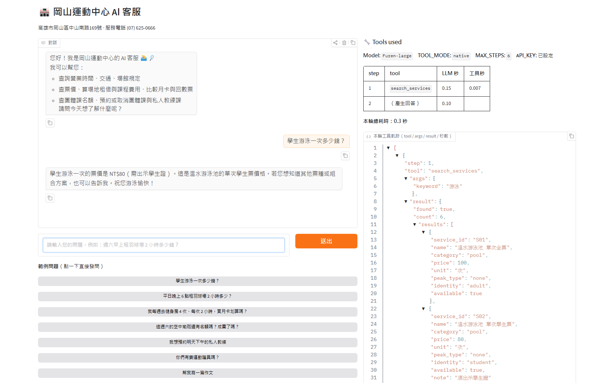
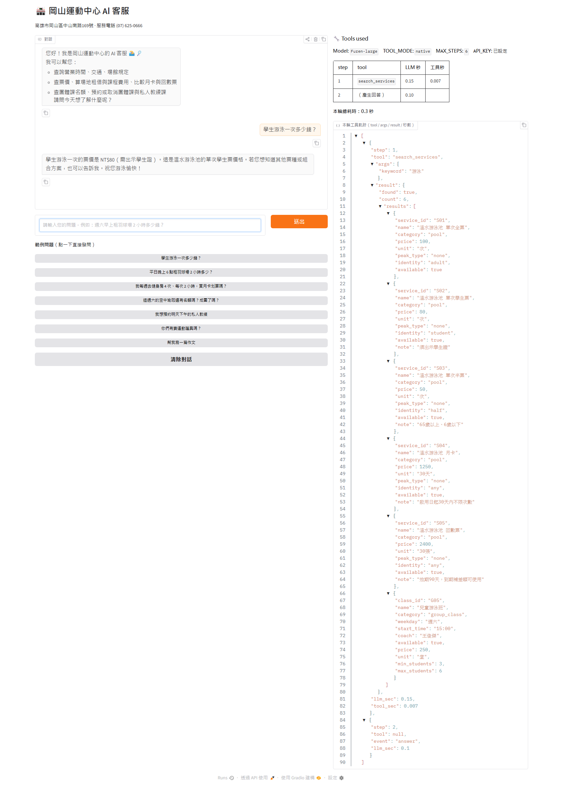
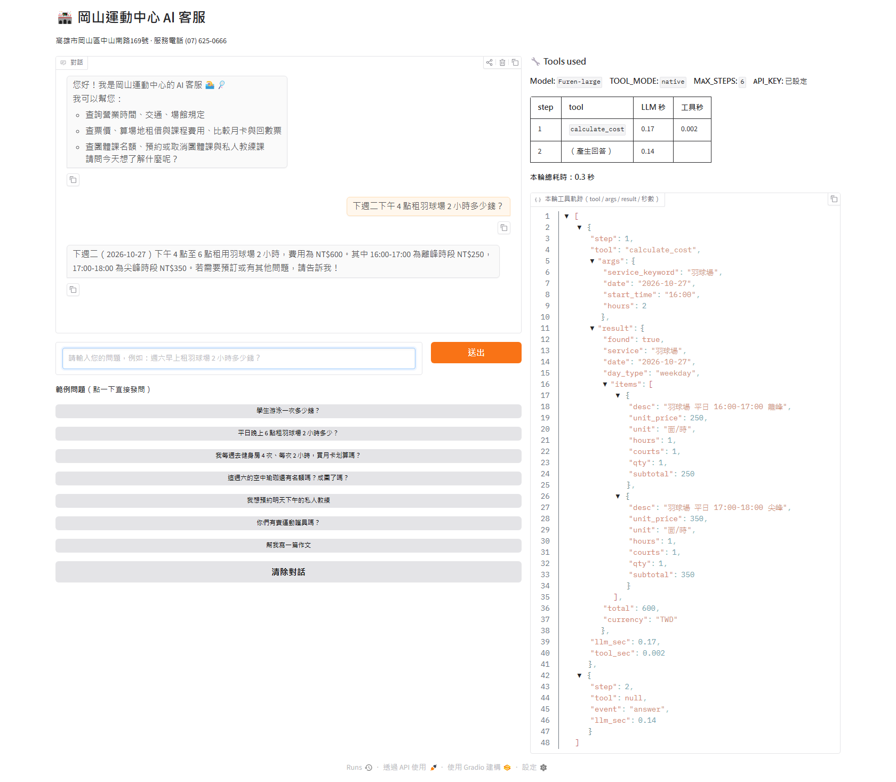
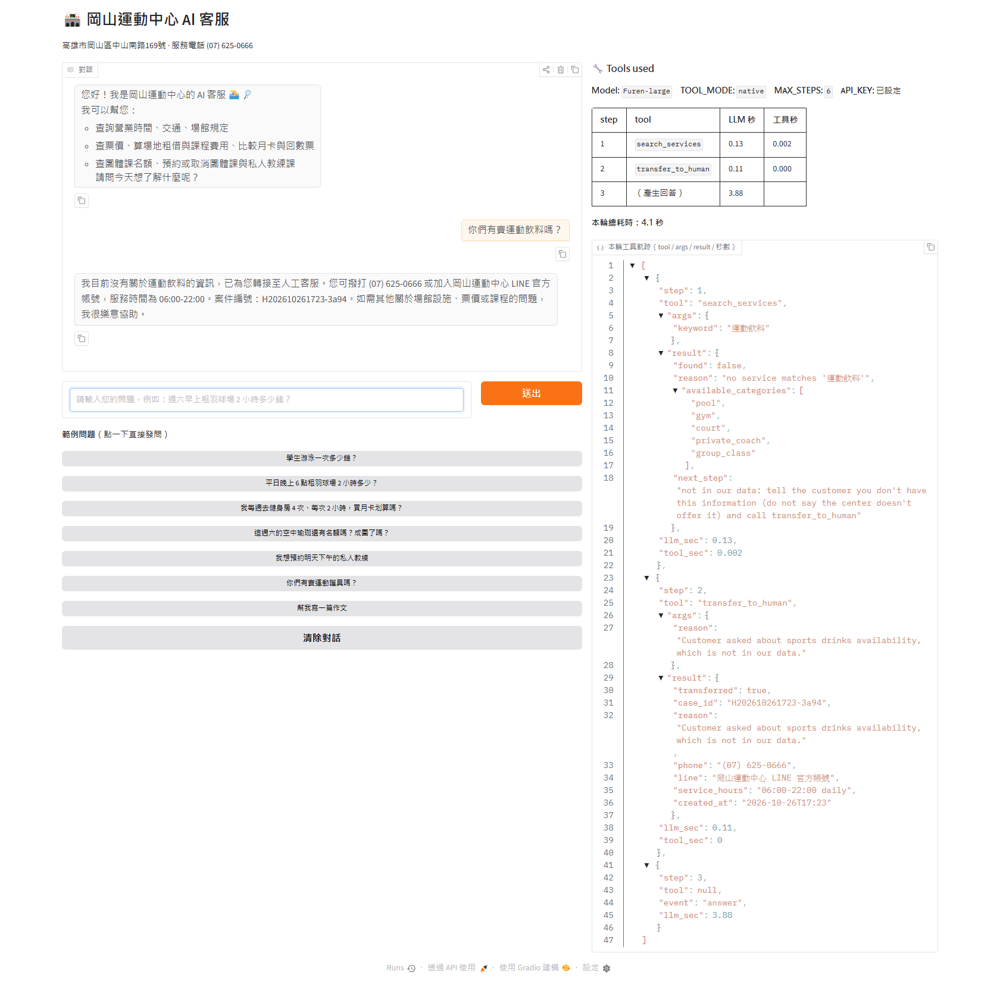
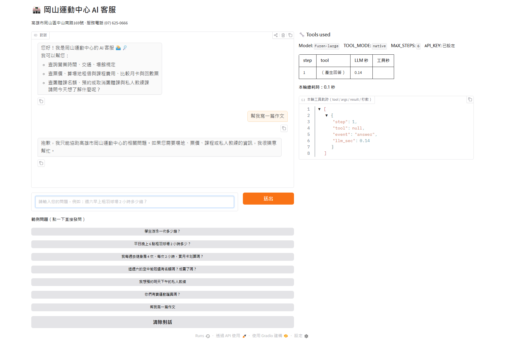
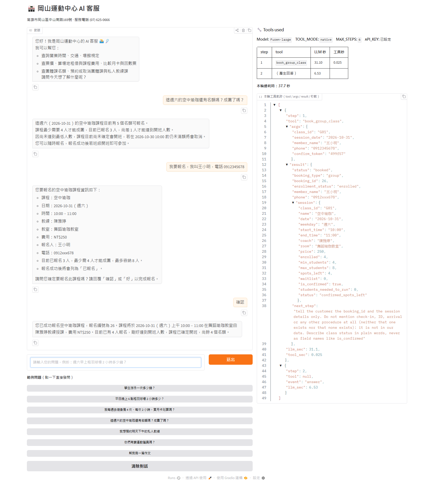

# Gangshan Sports Center AI Assistant: Answers Questions About Prices, Rules and Classes, and Books Coach Sessions

An AI customer service agent for **Gangshan Sports Center (高雄市岡山運動中心)** in Kaohsiung. Local residents, office workers,
students, seniors and parents can ask about opening hours, ticket and court prices, pool and gym rules, and group class places.
They can also book or cancel a group class or a private coach session. Every answer comes from a SQLite database through tools,
and the money is calculated in code, never by the model.

> Course homework: Unit G, My AI Customer Service Agent, with a Database and Tools
> Student: F113118101 Wenxin Shen (沈文鑫)



## Who It Serves and When They Use It

- **Who uses it:** people who live or work near Gangshan: swimmers and gym users who want the right ticket, students and
  seniors who want the discount price, badminton / pickleball players who rent courts, and parents asking about the kids' swimming class.
- **When they use it:** in the evening or on the way to the center, when they want a quick answer without calling,
  for example "Is the Saturday aerial yoga class full?" or "How much is a court from 4 to 6 pm?".
- **What problem it solves:** the same questions about prices, peak hours and rules come in every day, and the price of a court
  depends on the day and the hour (peak / off-peak). The agent answers them at once with exact numbers. It also keeps track of
  class places, minimum class sizes and the waitlist, and it takes bookings safely with a confirmation step.

## What It Can Do

| Function | Example question | Tool it uses |
|---|---|---|
| Opening hours, address, rules, parking, payment | 「健身房可以穿拖鞋嗎？」 | `get_center_info` |
| Ticket / rental / class prices, and whether something is offered | 「學生游泳一次多少錢？」 | `search_services` |
| Group class times, places left, enough students to run | 「這週六的空中瑜珈還有名額嗎？成團了嗎？」 | `list_group_classes` |
| Free private coach slots | 「明天下午有私人教練可以約嗎？」 | `find_private_slots` |
| Exact cost (peak / off-peak per hour, identity prices, 10-session pack) | 「平日下午 4 點租羽球場 2 小時多少？」 | `calculate_cost` |
| Which plan is cheapest (single / monthly pass / ticket book) | 「我每週去健身房 4 次、每次 2 小時，買月卡划算嗎？」 | `compare_plans` |
| Book a group class (joins the waitlist when full) | 「我要報名週六空中瑜珈，王小明 0912345678」 | `book_group_class` |
| Book a private coach session | 「明天 14:00 林志豪教練，陳大文 0987654321」 | `book_private_session` |
| Cancel a booking (the first person on the waitlist moves in) | 「我要取消報名編號 4」 | `cancel_booking` |
| Hand over to a person | 「我要客訴」「可以帶寵物嗎？」 (not in our data) | `transfer_to_human` |

## How It Works

Every question goes to the agent first. The agent chooses a tool, the tool reads the database or calculates in code,
and the agent answers only from what the tool returns. The chat page shows each step of the tool trace with its timing.

- **Model:** `Furen-large` on the NKUST iAI endpoint (OpenAI-compatible, native tool calling)
- **Chat screen:** Gradio (Blocks): chat on the left, "Tools used" trace on the right; the answer streams as it is written
- **Database (SQLite):** deleted and built again from the CSV files every time the program starts.

  | Table | CSV file | What it holds | Rows |
  |---|---|---|---|
  | `facility_info` (information table) | `data/facility_info.csv` | topics: opening hours, address and transport, contact, facilities, gym / pool rules, discounts, ticket rules, court peak hours, cancellation, parking, payment, class rules, coach rules, lost and found | 15 |
  | `services` (records table) | `data/services.csv` | tickets, court rental, coaching and class prices, peak / off-peak, identity, available or not | 20 |
  | `coaches` | `data/coaches.csv` | coaches, specialty, private price, private / group | 5 |
  | `coach_availability` | `data/coach_availability.csv` | weekly time windows for private sessions | 20 |
  | `group_classes` | `data/group_classes.csv` | weekly classes, coach, room, min / max students, price | 8 |
  | `group_enrollments` | `data/enrollments_seed.csv` (seed) | sample bookings: one class short by 1 person, one full with a waitlist, one running with places left | 25 |
  | `aliases` | `data/aliases.csv` | other names customers use (游泳 → 溫水游泳池, gym → 體適能中心, 空瑜 → 空中瑜珈, 學生 → student …) | 67 |
  | `private_bookings`, `pending_actions` | (created at start) | private bookings; preview tokens for the two-step confirmation | – |

- **Tools:** (all in `tools.py`; the agent can only run tools in this whitelist)

  | Tool | Kind | What it does |
  |---|---|---|
  | `get_center_info(topic)` | look up information | reads one topic from `facility_info` |
  | `search_services(keyword, category?)` | look up records | finds services and classes by forgiving names (aliases + partial match); unavailable items come back as `available: false` with no price |
  | `list_group_classes(keyword?, date?, weekday?)` | look up records | next sessions with enrolled / min / max, places left, waitlist, "will it run" |
  | `find_private_slots(date, coach_keyword?, specialty?)` | look up records | free hourly slots, minus booked sessions and the coach's group classes |
  | `calculate_cost(service_keyword, quantity, identity?, date?, start_time?, hours?)` | calculate | splits court time hour by hour into peak / off-peak, picks the identity price, compares single sessions with the 10-session pack |
  | `compare_plans(category, visits_per_month, hours_per_visit?, identity?)` | calculate | monthly cost of single entry / monthly pass / ticket book and the cheapest one |
  | `book_group_class(...)`, `book_private_session(...)`, `cancel_booking(...)` | change data | **two steps**: the first call only returns a preview and a `confirm_token`; the booking is written only when the agent calls again with the token after the customer confirms |
  | `transfer_to_human(reason)` | hand over | staff phone, LINE, service hours and a case summary |

- **Safety:** the model never writes SQL (all queries use `?` parameters); unknown tool names and wrong arguments return
  `{"error": ...}`; the loop stops after `MAX_STEPS` model calls; phone numbers are masked (`0912xxx678`, `曾○琪`) in tool results;
  an LLM call that takes more than 30 s returns a friendly message with the center's phone number.

## Sample Conversations











## Tests

| Test | How to run | Result |
|---|---|---|
| Unit tests (no LLM): tools, database rules, booking / cancel rules, agent loop with a fake LLM | `python -m pytest tests -v` | 107 passed |
| Tool-choice test, 24 questions | `python tests/run_tool_selection.py` | 23/24 → 24/24 after fixing the scope rule (later runs: 22–24/24; the model's choices vary a little from run to run) |
| Held-out test, 5 new questions | `python tests/run_tool_selection.py --cases tests/tool_selection_heldout.csv --out docs/tool_selection_heldout_results.md` | 5/5 |
| Scenario test (four kinds of question + full booking flow) | `python tests/run_scenarios.py` | all correct, see `docs/scenario_transcripts.md` |

Details, fixes and the speed measurements are in [`docs/test_results.md`](docs/test_results.md).

## Project Files

```text
w7_work/
├── app.py                  # Gradio chat page (run this)
├── agent.py                # agent loop: native tool calling or JSON fallback, streaming, retries, timing
├── tools.py                # the 10 tools, their schemas and the whitelist
├── db.py                   # builds SQLite from the CSV files; forgiving-name matching
├── prompts.py              # system prompt: role + grounding / scope / routing / language rules, today's date
├── check_model.py          # checks that the model supports tool calling
├── data/                   # the CSV files (the database is built from these)
├── tests/                  # unit tests, tool-choice test cases and runners, scenario runner
├── docs/                   # test results, transcripts, report notes, the plan used with Claude Code
├── images/                 # screenshots for this README
├── requirements.txt
├── .env.example            # sample settings (no real key)
└── .gitignore              # keeps .env, *.db, __pycache__/ and venv/ out of git
```

## How to Install and Run It

1. Download the project:

   ```bash
   git clone https://github.com/f113118101/nkust-115-w7-customer-service-agent.git
   cd nkust-115-w7-customer-service-agent
   ```

2. Install the packages (Python 3.10 or newer):

   ```bash
   python -m venv .venv
   .venv\Scripts\activate        # Windows
   source .venv/bin/activate     # macOS or Linux
   pip install -r requirements.txt
   ```

3. Make your settings file. Copy `.env.example` to `.env`, then put your own API key after `API_KEY=`.
   The model must support tool calling (`python check_model.py` checks this).

   ```bash
   copy .env.example .env      # Windows
   cp .env.example .env        # macOS or Linux
   ```

   | Setting | Meaning |
   |---|---|
   | `LLM_API_URL`, `MODEL_NAME`, `API_KEY` | the OpenAI-compatible endpoint, the model and your key |
   | `TOOL_MODE` | `auto` (default: checked once when the app starts), `native` or `json` (for models without tool calling) |
   | `MAX_STEPS` | the most model calls for one question (default 6) |

4. Start the agent. It builds the database from the CSV files, then opens the chat page:

   ```bash
   python app.py
   ```

5. Open the link shown in the console, usually <http://127.0.0.1:7860>.

## How I Worked with AI

I built this project together with **Claude Code** in the console. I wrote the plan, the data rules and the decisions, and
Claude Code wrote and tested the code phase by phase. After each phase I checked the result and decided what to change.
The plan we worked from is in [`docs/CLAUDE_CODE_PLAN.md`](docs/CLAUDE_CODE_PLAN.md), and the test and fix log is in
[`docs/test_results.md`](docs/test_results.md).

## Notes

- **Real data:** ticket and court prices, opening hours, address, phone, facilities, entry rules and peak hours come from the
  Gangshan Sports Center page on the website of its operator, 舞動陽光.
- **Demo data:** the coaches, class timetable, sample bookings, coaching and class prices, payment methods, parking details,
  cancellation and lost-and-found rules are **made up for this demo**. They are marked「（示範資料）」in `data/facility_info.csv`
  and "示範資料" in `data/services.csv` / `data/coaches.csv`. All names and phone numbers in the sample bookings are made up.
- The `.env` file holds the API key. It is **not** in this repository. Make your own from `.env.example`.
- The database file (`center.db`) is not in the repository either; the program builds it from the CSV files at every start,
  so all bookings made while testing are cleared on restart.

## Future Improvements

- **`find_my_bookings`**: let a customer look up their own bookings by phone number (today they need the booking number to cancel).
- **Model comparison and thinking mode**: compare Furen-std / Furen-omni and Furen-large with thinking turned off
  (`THINKING=off_kwargs` is already supported but not yet measured), and switch only if accuracy stays the same and it is clearly faster.
- Notify a waitlisted customer when they are moved into a class, and cancel classes automatically when they are still short of
  the minimum 24 hours before the start.
- Keep bookings in a database that survives restarts.
- Watch the model's booking replies: before the fix in `docs/test_results.md` section 6 it added a check-in sentence that
  is not in the data. If the center has a real check-in rule, add it to `facility_info.csv`.
